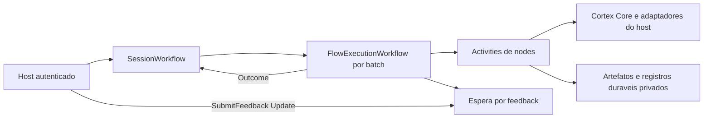

# Migracao da execucao do Cortex para Temporal

Data: 2026-10-05. Base inspecionada: `1ac2b1b` em `C:/dev/cortex`.

Status: especificacao para revisao. A escolha de Temporal foi aprovada na
conversa; esta especificacao ainda precisa ser revisada antes do plano e da
implementacao. Nenhuma migracao de dados ou ativacao operacional foi realizada.

## Objetivo e criterio de sucesso

Migrar a administracao de execucoes, fila por sessao, timers e esperas humanas
para Temporal. Uma execucao aguardando feedback deve sobreviver ao encerramento
do worker e continuar com a resposta correta, preservando resultados anteriores,
identidade de execucao, revisao do grafo e regras de efeitos externos.

O Cortex continua responsavel pelos contratos, tipos, compilacao e semantica dos
nodes. Temporal administra o progresso duravel. A aplicacao apresenta pedidos de
feedback e autentica quem responde. Redis nao faz parte desta migracao.

Esta e uma mudanca arquitetural. O desenho cobre o destino e as etapas de
migracao; instalar uma dependencia sem substituir a administracao de execucoes
nao satisfaz o objetivo.

## Evidencia do runtime atual

- `SessionFlowRuntime.Execution.cs`, `QueueBatchLocked`: serializa batches por
  uma cadeia de `Task.Run`/`state.Tail`. Cada batch captura mensagens, historico,
  projeto e estado. Esperar feedback dentro dessa chamada conserva esse contexto
  no processo e posterga os batches seguintes.
- `TypedFlowRunner.cs`, `RunCoreAsync`: mantem cursor, valores, outputs,
  referencias e estado de envio em variaveis locais.
- `SessionFlowRuntime.Context.cs`, `CaptureContext`: so captura sessoes sem
  buffers abertos nem execucoes pendentes; nao recupera um node interrompido.
- `BoundaryExecutionRegistry.cs`: referencias de memoria/limites correspondem a
  snapshots confiaveis em dicionarios da execucao. Serializar apenas os tokens
  nao preserva a proveniencia necessaria para retomar.
- `OutboundJournal.cs` e `ShadowOutboundHost.cs`: reserva, recibo, resultado
  indeterminado e reconciliacao possuem semantica propria. Um retry generico nao
  pode substituir esse contrato.
- `ShadowInboundJournal.cs`: ja existe captura duravel de inbound, com epoca,
  cursor e autoridade; seus registros nao sao uma fila automaticamente retomavel.

O projeto nao esta indexado no codebase-memory. Os pontos acima foram conferidos
diretamente nos arquivos. O checkout contem alteracoes alheias de Personas e
`Cortex.slnx`; devem ser preservadas.

## Abordagens consideradas e escolha

| Abordagem | Implicacao | Decisao |
| --- | --- | --- |
| Runner inteiro em uma Activity | A espera continua dentro de uma tentativa; recuperacao tem pouca granularidade | Descartada |
| Um Workflow permanente com todos os nodes e dados da sessao | Mistura historico de sessao e de execucao, ampliando payloads e versionamento | Descartada |
| Coordenador de sessao e Workflow filho por execucao | Separa admissao, fila e estado da sessao do progresso de um batch | Escolhida |

## Modulos e responsabilidades

| Modulo | Responsabilidade |
| --- | --- |
| `Cortex.Core` | Contratos duraveis neutros, compilacao, avaliacao dos nodes e validacao dos resultados |
| Novo `Cortex.Temporal` | Cliente, Workflows, Activities, registro do worker e configuracao Temporal |
| Novo `Cortex.Temporal.Tests` | Testes de contrato, integracao, recuperacao e replay |
| Host consumidor | Autenticacao, bindings, adaptadores de inferencia/memoria/transporte, armazenamento privado e UI |

`Cortex.Core` nao referencia `Temporalio`. O adapter referencia Core e o SDK
.NET. O editor `flow-graph` continua generico: a paleta e o formulario de
feedback pertencem ao host. A integracao da aplicacao Filo e a troca operacional
do backend constituem uma etapa explicita de cutover; nao devem ser alegadas
como concluidas por adicionar o adapter neste repositorio.

## Topologia de execucao

Um `SessionWorkflowV1` administra cada `SessionKey` completo: runtime,
personagem, canal, conta e conversa nativa. Seu ID usa uma codificacao canonica
e um hash desses campos, incluindo a identidade da instalacao do host. Ele
mantem o estado atual, versao, watermark, descritores dos buffers, fila de refs
de batches e identidade da execucao ativa.

Um `FlowExecutionWorkflowV1` filho executa um batch. Seu ID deriva da identidade
duravel do batch; `ExecutionId` nao muda com retry, restart ou novo Temporal
`RunId`. Ele recebe refs imutaveis de projeto, inputs e estado inicial, e
administra cursor, ordinal e estado de espera por meio de descritores pequenos.

O coordenador conserva a serializacao atual: no maximo um batch operacional
ativo por sessao. Enquanto ele espera feedback, novos inputs podem ser admitidos
e enfileirados, mas nao executam efeitos sobre o mesmo estado. Outras sessoes
continuam normalmente. Permitir execucoes concorrentes na mesma sessao seria
uma alteracao de semantica separada.

Admissao e feedback usam Updates com resultados verificaveis. Um timeout do
cliente nao comprova rejeicao; repetir usa a mesma chave de operacao. Queries
exibem estado e solicitacoes pendentes sem mudar o Workflow. Cancelar um pedido
ou execucao e uma operacao de dominio; parar o worker apenas interrompe o
processamento e nao cancela os Workflows.

## Estado, artefatos e proveniencia

Extrair a execucao de nodes de `RunCoreAsync` para um kernel reutilizavel, com
snapshot explicito, que avance ate uma operacao, espera ou termino. O runner
local usa o mesmo kernel como harness de compatibilidade. O Workflow nao
transporta delegates, `Task`, `CancellationToken`, locks ou adaptadores do host.

Cada Activity carrega um snapshot privado, executa um node operacional e grava
um novo snapshot imutavel antes de devolver o descritor ao Workflow. Projecoes
e comparacoes puras consecutivas podem ser avaliadas no mesmo passo limitado.
Uma Activity nao pode atravessar uma espera humana nem executar o grafo completo
como unidade de retry.

O snapshot identifica sessao, projeto/versao/revisao, grafo, batch, execucao,
cursor, ordinal, valores tipados, mapa de referencias e fatos de efeitos
confirmados. A Activity valida tipos, escopo e integridade ao carregar. A escolha
de saida e registrada como resultado da Activity, de modo que replay reutilize
essa decisao em vez de buscar dados atuais para reinterpretar o passado.

Uma interface neutra `IExecutionArtifactStore` administra refs opacas, leitura
por escopo e gravacao imutavel por chave de operacao. O primeiro adapter duravel
usa diretorio privado configurado pelo host, escrita atomica e exclusao mutua
por instalacao. Todas as refs carregam versao, digest e escopo; colisao de chave
com conteudo diferente e erro. Uma versao em memoria serve apenas aos testes de
contrato e nao satisfaz recuperacao.

Essa primeira implantacao e de uma instalacao com armazenamento local duravel:
um processo substituto acessa o mesmo armazenamento e bindings. Activities de
efeitos usam uma task queue vinculada a essa instalacao. Distribuir esses
efeitos para outras maquinas exige store compartilhado e propriedade exclusiva
do transporte/journal; nao e uma garantia implicita desta versao.

Snapshots de memoria e limites sao persistidos como evidencia confiavel do
host, vinculados a execucao, namespace, revisao e integridade. O registry e
reconstituido desses registros pelo kernel, nunca de um token fornecido pelo
modelo, grafo ou usuario. Sua validade temporal e verificada novamente antes de
uso. Referencia persistida nao e permissao de inferencia nem de envio.

Dados privados, historico, prompts, respostas e texto de feedback ficam no
store privado; os payloads Temporal carregam refs, digests e metadados de
controle. Nao enviar objetos completos de conversa para Event History. Refs
tambem sao dados internos: acesso ao namespace Temporal e ao store deve ficar
restrito ao host. Artefatos de execucoes abertas sao retidos; limpeza de fechadas
usa politica do host e nao elimina evidencia exigida pelos journals.

## Admissao, buffers e crescimento

O host persiste o input canonico antes de pedir admissao e nao avanca o cursor
de origem sem confirmacao duravel. A chave inclui instalacao, sessao, epoca e
identidade do provider; repetir o mesmo conteudo devolve a decisao anterior.
Reutilizar a chave com conteudo diferente e rejeitado.

O registro duravel de admissoes associa input a watermark, batch e execucao.
Ele conserva deduplicacao atraves de rotacoes e restarts, sem acumular todos os
IDs em RAM ou nos parametros de Continue-As-New. Mudanca de epoca continua
exigindo a reconciliacao de origem ja existente.

Os limites atuais de historico e configuracao dos acumuladores sao preservados.
Quiet period e max wait usam timers Temporal; max messages usa admissao
deterministica. A publicacao do projeto mantem as revisoes dos buffers e batches
ja capturados. A regra atual de reprocessar ou bloquear batch com envio sob
estado obsoleto continua antes do inicio dos efeitos.

Adicionar limite de backlog por sessao configurado pelo host: default de 256
batches pendentes, admitindo valores de 1 a 4096. Cada buffer aberto reserva uma
vaga nesse limite; fechar o buffer converte a reserva em batch pendente, sem
precisar adquirir outra vaga. A execucao ativa nao conta nesse limite. Ao
atingir o limite, admissoes que precisam de nova vaga retornam
`session-backlog-full` sem consumir watermark nem confirmar
cursor. O input ja persistido permanece disponivel para retry; nada e descartado
silenciosamente. Duplicatas previamente admitidas ainda recebem sua decisao
anterior. Mensagens que cabem em buffer ja aberto seguem os limites desse buffer;
registros outbound confirmados nao reservam vaga para nova execucao.

O coordenador usa Continue-As-New quando sugerido pelo SDK, em ponto seguro sem
filho ativo, buffers abertos ou handlers incompletos. Se o limite se aproxima
sem ponto seguro, admissao aplica backpressure ate permitir a rotacao. O novo
Run preserva estado, watermark, refs da fila e versao do protocolo. Outcomes,
traces e recibos sao registros duraveis paginados, em vez de listas sem limite
no objeto da sessao.

## Node `humanFeedback`

Kind: `humanFeedback`, block version 1, disponivel no compilador tipado e no
catalogo. Configuracao obrigatoria: pergunta textual nao vazia. Input opcional
`context`: String. Outputs na resposta: `feedback`: String. Controle: `run`;
saidas `then` e `timeout`. Timeout em segundos e opcional, inteiro positivo;
sem timeout, a espera permanece aberta ate resposta ou cancelamento. Quando
configurado, a saida `timeout` deve estar conectada; ela nao publica feedback.

Ao visitar o node, gravar pergunta, contexto e digest em um pedido imutavel.
`RequestId` deriva de execucao, node e ordinal, independente do Temporal RunId.
O Workflow passa a `waitingForHuman` e espera uma condicao duravel, sem Activity
longa, polling de usuario ou `TaskCompletionSource` mantido pelo host.

O cliente oferece leitura paginada dos pedidos de uma sessao e consulta de um
pedido por identidade. `SubmitFeedback` recebe RequestId, identidade esperada
da execucao/revisao, digest do pedido e ref do texto persistido pelo host.
O host autentica o respondente, verifica sua autorizacao atual e produz a
identidade auditavel; campo `actorId` preenchido por um cliente nao autentica.

O Update aceita somente o pedido ativo correspondente. Resposta vazia, escopo
errado, revisao/digest incorretos, pedido expirado/cancelado ou identidade
divergente sao rejeitados. Repeticao com a mesma operacao e conteudo devolve o
recibo original; nova resposta conflitante ao mesmo pedido e rejeitada.

Resposta e timeout competem pela ordem dos eventos processados no Workflow:
somente a primeira resolucao valida encerra o pedido. Cancelamento nao percorre
`then` nem `timeout`; termina a execucao como cancelada. Pedido aberto e visivel
apos reiniciar o worker. Entregar feedback nao autoriza um efeito externo.

## Activities, retries e efeitos

As chaves de passo incluem instalacao, sessao, execucao, node, ordinal e revisao;
nao usam attempt number ou Temporal RunId. Se ja ha resultado duravel completo
da mesma operacao, a Activity devolve-o sem executar novamente o node.

Leitura/escrita idempotente de artefatos e passos puros podem repetir ate cinco
tentativas com backoff de 1 a 30 segundos. Inferencia paga e envio usam uma
tentativa por default. Seus timeouts sao fornecidos pelo binding do host,
positivos e finitos; nao criar retry automatico que repita uma chamada paga ou
um envio de resultado desconhecido.

Quando uma Activity de efeito falha ou perde a resposta, o Workflow primeiro
agenda recuperacao de resultado por sua chave. Resultado confirmado e
reutilizado. Resultado desconhecido permanece explicitamente falho ou
`reconciliationRequired`; nao e convertido em sucesso ou reenviado. Uma chamada
de modelo concluida no provider sem resultado persistido pode ter custo sem
resultado recuperavel; nao prometer exactly-once para essa chamada.

Cada tentativa refaz bindings e verifica autorizacao atual para a revisao
capturada. Permissoes revogadas ou adaptadores indisponiveis interrompem o passo.
Alterar o projeto publicado nao substitui automaticamente a revisao de uma
execucao aberta nem concede permissao para essa revisao.

O journal outbound permanece autoridade sobre reserva e recibo. Integrar o
checkpoint do node com sua recuperacao: envio confirmado e incorporado ao
historico uma vez; resultado indeterminado impede nova tentativa ate
reconciliacao explicita com evidencia. Preservar kill switch, rota exata,
limites, selecao de reply e controles de limites. A transicao dependente de
fala so ocorre com recibo confirmado. Nenhuma Activity pode contornar o host
porque recebeu feedback humano.

## Versionamento e compatibilidade

Separar versao do protocolo de execucao, revisao do projeto e versao do worker.
Workflows V1 e snapshots V1 possuem codecs explicitos. Workflow logic usa
somente mecanismos deterministas do SDK; I/O, relogio externo, geracao aleatoria
e adaptadores ficam nas Activities. Mudancas incompatíveis usam novo tipo de
Workflow ou patch/versionamento Temporal, com testes de replay.

Criar um contrato assincrono de backend de sessao para publicar projeto,
admitir input, consultar snapshot/history/outcomes/traces, aguardar idle,
cancelar execucao e administrar feedback. Leituras remotas sao assincronas e
paginadas; evitar `.Result`/`.GetAwaiter().GetResult()` para emular APIs locais.

O runtime local permanece durante a transicao como backend de compatibilidade
e harness. Sessao seleciona exatamente um backend; nao executar em ambos com
efeitos reais. A migracao termina quando o host usa Temporal como administrador
das sessoes e esperas, com paridade verificada. A permanencia do harness local
nao significa que ele continue coordenando a execucao Temporal.

Reavaliacao de participacao, previews e continuacao revisada integram o mesmo
contrato: reutilizar respostas ja aprovadas, preservar snapshot e verificar
obsolescencia/confirmacao de fala. Nao migrar apenas o caminho basico e declarar
paridade completa.

## Etapas da migracao e cutover

1. Extrair kernel e snapshots com testes diferenciais contra o runner atual;
   implementar store duravel e reconstituicao de evidencia.
2. Implementar adapter Temporal, execucao por node, recuperacao e feedback humano
   com grafo sintetico e efeitos fake; incluir pausa/restart/resposta/retomada.
3. Implementar coordenacao de sessao, deduplicacao, batching, timers, projeto,
   estado, paginacao e rotacao. Integrar os caminhos de revisao e preview.
4. Implementar adaptacao host-bound de inferencia/memoria/envio e provar os
   cenarios de crash com journal, ainda sem envio externo real.
5. Integrar o host consumidor, drenar o backend local e importar apenas contexto
   ocioso e reconciliado. Registrar um marcador de cutover com revisao, estado,
   watermark e cursor de origem. Preservar registros e identidades anteriores;
   nao reexecutar batches concluidos nem importar continuacoes de Task.
6. Verificar paridade em ambiente isolado e habilitar Temporal por sessao. Apos
   efeitos novos, rollback exige drenar e reconciliar estado/recibos; nao basta
   trocar uma flag para um checkpoint local antigo.

Endpoint, namespace, task queues e diretorio de artefatos sao configuracao
explicita do host. Desenvolvimento/aceitacao usam servidor Temporal local
isolado e fixtures sinteticas. A escolha de um servico Cloud, deploy, alteracao
de servicos existentes ou cutover de conversas reais necessita contexto
operacional concreto; esta especificacao nao escolhe credenciais nem destino.

## Verificacao e criterios de aceite

- Todos os kinds hoje executaveis preservam validacao, outputs, exits,
  transicoes, history frontier, revisoes e traces relevantes.
- Feedback depois de parar e recriar o worker retoma no proximo node; uma
  inferencia anterior com resultado persistido ocorre uma vez nesse cenario.
- Duas sessoes independentes progridem enquanto uma espera feedback. A mesma
  sessao conserva ordem e aplica backpressure no limite de backlog.
- Repeticao de inbound e de feedback preserva recibo; conteudo conflitante,
  wrong scope, resposta tardia e cancelamento nao avancam o grafo.
- Batching e timeout funcionam com time skipping; cancelamento nao envia nem
  perde o estado da solicitacao. Parar o worker nao cancela o pedido.
- Replay de historicos sinteticos funciona apos restart e mudancas compativeis;
  Continue-As-New conserva watermark, fila, estado e deduplicacao.
- Memoria/limites sobrevivem a restart com proveniencia, escopo e validade;
  token forjado, fonte expirada ou namespace errado sao rejeitados.
- Crash antes/depois de reserva, chamada externa, recibo, gravacao de snapshot e
  commit de historico nao causa reenvio automatico. Outcomes desconhecidos
  exigem reconciliacao; recibos recuperados nao duplicam historico/transicao.
- Serializacao nao envia conversas/prompts/feedback completos nem credenciais
  para Event History. Store falta/corrompido/escopo errado falha explicitamente.
- Core nao depende do SDK Temporal; alteracoes alheias e artefatos congelados
  permanecem preservados. Atualizacoes da solution sao aditivas.

Testes de kernel/store rodam sem servico. Integracao usa o servidor de teste
Temporal e Activities fake; SDK pode precisar baixar binarios na preparacao,
por isso disponibilidade do ambiente deve ser verificada e documentada.
Replay e teste de restart com servidor persistente complementam time skipping;
um teste apenas em memoria nao comprova durabilidade. A validacao de cutover e
do host e separada da suite offline do Cortex.

## Fundamento tecnico

Temporal reconstrói o estado por replay de Event History e reutiliza resultados
de Activities ja registrados. Isso embasa a separacao entre controle duravel e
operacoes do host, sem pressupor exactly-once de efeitos externos.
[Tasks e recuperacao](https://docs.temporal.io/tasks),
[Activities](https://docs.temporal.io/activity-definition).

Updates permitem confirmar tratamento e validar mensagens; condicoes de espera
e timers mantem o pedido humano aberto no Workflow.
[Message passing .NET](https://docs.temporal.io/develop/dotnet/workflows/message-passing).

Filhos separam execucoes, e Continue-As-New permite renovar o historico do
coordenador. Rotacao deve ocorrer com handlers finalizados e estado transportavel.
[Child Workflows](https://docs.temporal.io/develop/dotnet/workflows/child-workflows),
[Continue-As-New](https://docs.temporal.io/develop/dotnet/workflows/continue-as-new).

Versionamento e replay tests protegem execucoes abertas de mudancas no codigo.
A suite .NET fornece servidor local e ambiente com time skipping.
[Versioning](https://docs.temporal.io/develop/dotnet/workflows/versioning),
[Testing](https://docs.temporal.io/develop/dotnet/best-practices/testing-suite).

## Registro de trabalho desta etapa

- [x] Escolha de Temporal confirmada pelo usuario.
- [x] Runtime, checkpoint, memoria/limites e journals inspecionados.
- [x] Desenho escrito com topologia, invariantes e etapas de migracao.
- [x] Revisao final de consistencia da especificacao: sem placeholders,
  contrato de pausa/retomada explicito, backlog com reserva por buffer,
  separacao de progresso e autoridade, e cutover condicionado a paridade.
- [ ] Revisao da especificacao pelo usuario.
- [ ] Plano detalhado revisado e metodo de execucao escolhido.
- [ ] Implementacao e verificacao.
- [ ] Integracao do host e cutover operacional.
