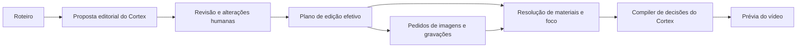

# Plano de decisões de edição

O Cortex propõe um plano de edição por cena junto com o roteiro. A pessoa responsável pelo vídeo revisa a proposta, altera seus parâmetros e acompanha sua execução na prévia. O plano registra a intenção editorial, sua justificativa e a autoria das alterações; a resolução de mídia transforma essa intenção em ações que o renderer consegue executar.

Este desenho define a fundação compartilhada no Cortex e a primeira integração no Depois do Slogan. O primeiro efeito executável é uma imagem aparecer e aproximar um ponto ou trecho, começando pela abertura do vídeo atual. O plano completo pode ser proposto antes de existirem gravações ou imagens finais.

## Comportamento esperado

Ao gerar um roteiro, o Cortex também propõe as decisões de edição. Ao abrir a revisão, os controles já estão preenchidos. Cada cena mostra o material pretendido, a apresentação, o movimento, os textos, os momentos planejados e uma justificativa em português. A pessoa pode alterar um valor, desligar o efeito, aceitar a proposta ou pedir uma nova proposta para aquela cena.

Uma alteração manual vira uma decisão preservada. Uma atualização de roteiro ou material atualiza as dependências afetadas e identifica conflitos, sem apagar ajustes humanos. Uma falha do planejador deixa o roteiro disponível para edição e apresenta uma tentativa manual de planejamento; não dispara novas chamadas ao modelo continuamente.

## Contratos existentes

O Cortex já tem os documentos `cortex.edit.v1`, `cortex.edit.plan.v1`, `cortex.edit.recording_tasks.v1` e `cortex.edit.resolved.v1`. Eles distinguem roteiro, candidatos de mídia e pendências, tarefas de gravação e timeline resolvida. `VisualIntent.Focus` já permite o alvo textual de `crop_zoom` e um retângulo em pixels, mas ainda não descreve movimento ao longo do tempo.

O `EditPlanDocument` atual registra seleção de clipes, evidências e necessidades de mídia. Esse significado permanece. O novo **Plano de edição** apresentado no produto é uma proposta editorial que também existe antes de selecionar clipes. O renderer de cortes legado ainda usa `TakeEditPlan`; a adaptação completa de montagem com gravações fica fora da primeira entrega.

Evidências: [documentos](../../../src/Cortex.Video/Editing/EditingDocumentModels.cs), [intenções](../../../src/Cortex.Video/Editing/EditingIntentModels.cs), [decisões e timeline](../../../src/Cortex.Video/Editing/EditingResolutionModels.cs) e [contrato atual](../../cortex-edit-v1.md).

## Documento de decisões

Adicionar o documento complementar versionado `cortex.edit.decisions.v1` à biblioteca opcional Video do Cortex. Seus campos executáveis terão modelos C#, JSON Schema, tipos de fluxo e validação próprios. Dados que determinam uma renderização não ficam escondidos em anotações livres de `metadata`.

O documento contém `project_id`, `plan_id`, `revision`, referência e SHA-256 do roteiro de origem, fingerprint do contexto editorial, estado de revisão e decisões ordenadas por `beat_id`. Há exatamente uma cena do plano para cada cena do roteiro, na mesma ordem. Referências a cenas, fontes e textos precisam existir nesse roteiro.

Cada decisão de cena contém:

| Grupo | Conteúdo |
|---|---|
| Objetivo | Papel editorial da cena e justificativa da proposta. |
| Material | Fonte, pessoa ou peça gráfica pretendida; preferência por upload final; referência gerada como alternativa provisória. |
| Apresentação | Tela inteira, apoio central ou lado a lado; proporção da imagem, região no quadro e ajuste `contain` ou `cover`. |
| Tempo | Duração estimada, entrada e saída; pontos de início relativos à cena ou gatilhos de fala. |
| Movimento | Efeito permitido, parâmetros, alvo e sequência de ações. |
| Texto | Referências aos overlays autorais e perfil de legenda vigente, com reserva de espaço. |
| Revisão | Origem de cada valor, estado de revisão e pendências que precisam ser resolvidas. |

O modelo escolhe valores em um catálogo permitido. Não entrega expressões FFmpeg, código, CSS, comandos ou caminhos arbitrários. A validação confere limites, discriminantes e consistência das decisões antes de persistir a proposta.

## Intenção e resolução

O plano editorial pode pedir “mostrar o post completo e aproximar a frase X”. Essa decisão não contém coordenadas presumidas nem afirma que o modelo viu uma imagem ou gravação.

Quando houver mídia, a resolução cria um artefato separado vinculado à revisão exata do plano e às dimensões e hashes dos arquivos reais. Ele contém o material selecionado, o retângulo do foco, os tempos resolvidos e as pendências. Trocar uma imagem invalida suas coordenadas; editar uma fala invalida seus gatilhos de palavra. Os alvos e parâmetros editoriais permanecem disponíveis para revisão.

O foco textual tem estados `pending_media`, `needs_review` ou `resolved`. A primeira entrega permite marcar a área da imagem no editor e registra a origem humana dessa resolução. Se o roteiro já tiver um retângulo válido para a mesma mídia, ele é reaproveitado. O planejamento pelo Cortex continua automático; localização automática de texto por OCR ou visão é uma extensão posterior, com evidência e validação próprias. O sistema não presume uma área para um alvo textual que não conseguiu localizar.

Uma prévia de planejamento pode usar durações estimadas e avisos explícitos de pendência. Uma intenção de zoom com foco textual pendente fica visível como pendência e não é executada como se o alvo estivesse resolvido. Na renderização final, todos os requisitos executáveis precisam estar resolvidos. Gatilhos de fala ausentes ou ambíguos nunca ganham timecodes inventados.

## Primeira animação

O catálogo inicial admite entrada da camada de imagem por `cut` ou `fade`, movimento `none` ou `zoom`, interpolação `linear` ou `ease_in_out` e alvo `center`, `point` ou `text_region`. Saídas entre cenas continuam usando corte direto. O fade pertence à camada da imagem e não implica uma transição entre duas cenas.

O movimento usa tempo local da cena, início e duração explícitos, escala inicial e final e foco resolvido. Escalas ficam entre 1 e 2,5; início e duração são finitos, positivos quando aplicável e cabem na cena. Entradas e saídas usam a mesma base de tempo. Uma cena curta recebe uma proposta que respeita esses limites; o renderer rejeita parâmetros inválidos em vez de corrigi-los silenciosamente.

O compiler converte os parâmetros em uma sequência determinística de opacidade e transformação 2D. O renderer preserva a proporção da imagem, limita a amostragem aos pixels válidos e mantém o recorte dentro da região de apresentação. Overlays e legendas são compostos depois da imagem e mantêm seu próprio tamanho. A imagem usada na animação pode ser recebida ou gerada.

Exemplo da abertura de 3 s: fade de 0 a 0,25 s; post completo até 0,8 s; aproximação de 0,8 a 2,2 s; enquadramento final mantido até 3 s. A frase-alvo vem do roteiro existente. A escala final de 1,35 é uma proposta inicial editável; o retângulo fica pendente até ser resolvido sobre o post real.

## Autoria e atualização

As origens dos valores são `cortex`, `human` e `inherited`. Uma camada explícita de alterações humanas guarda os grupos alterados e os caminhos dos campos modificados. A proposta do modelo permanece registrada separadamente, permitindo comparar o que foi sugerido com a decisão efetiva.

Recalcular uma cena preserva os campos alterados manualmente. Há uma ação explícita “Usar proposta do Cortex” para retirar uma alteração humana escolhida. Uma aceitação sem alterações registra a revisão humana, sem fabricar uma edição manual de todos os campos.

Revisões utilizam o número da revisão base: uma gravação baseada em versão antiga é rejeitada como conflito. IDs de cena são estáveis enquanto a cena mantiver sua identidade. Se uma nova geração remover uma cena ou reutilizar seu ID para um propósito diferente, suas alterações ficam preservadas como conflito para revisão, sem serem aplicadas automaticamente à nova cena.

Mudanças na apresentação ou no movimento invalidam a prévia. Mudanças apenas na animação não geram outra imagem. As referências só são regeneradas quando a composição ou o tamanho solicitado mudarem. Nenhuma atualização altera o arquivo enviado pelo usuário.

## Componentes e fluxo

`Cortex.Video.Editing` possui os contratos, validação, compilação dos parâmetros e execução compartilhada de movimento. O plugin Depois do Slogan possui o briefing editorial e o planejador por modelo, usando o `IFlowCompletion` existente. O host do produto persiste revisões, aplica autorização, coordena tarefas e detecta resultados obsoletos. A interface apresenta as cenas e seus controles, sem precisar expor nodes.

O fluxo principal ganha uma etapa de proposta editorial depois do roteiro. Ela roda automaticamente na geração inicial e fica disponível para recalcular cenas afetadas. O modelo recebe o roteiro completo como contexto, as cenas a recalcular, o formato, os parâmetros disponíveis e as alterações humanas preservadas. O resultado precisa cobrir somente os IDs solicitados, com textos e fontes do roteiro. Um resultado baseado em fingerprint antigo é descartado se o contexto relevante mudar durante a chamada.

O planejamento visual já existente é absorvido por essa proposta: tamanho, composição, apresentação e movimento passam a sair de uma decisão coerente. A adaptação conserva as referências e os arquivos atuais. Clipes selecionados pelo resolver de gravações mantêm seus candidatos, evidências e origem; o plano editorial não substitui essa seleção nem inventa uma gravação existente.

## Interface e persistência no produto

Roteiro recebe a seção “Plano de edição” em cada cena, com um resumo da proposta, justificativa e controles de material/apresentação, entrada, zoom e foco. A marcação do foco usa o preview da imagem selecionada e suas dimensões naturais. Legendas e overlays permanecem acessíveis pelos controles existentes, e o plano referencia seus valores vigentes.

O editor continua disponível enquanto uma proposta é calculada. O estado identifica a cena em planejamento, uma falha ou um resultado pronto. Falhas são tentadas novamente apenas por uma ação explícita ou uma mudança relevante de contexto. Aprovar a lista de gravação não significa aprovar automaticamente cada decisão de edição.

O banco do site guarda versões do documento, propostas e alterações humanas, separadas do roteiro autoral e das resoluções de mídia. Exportar o projeto inclui o roteiro e o documento complementar; importar valida os dois e as relações de cena. Documentos antigos continuam carregando e podem receber uma primeira proposta. O controle de acesso segue o proprietário editor; viewers recebem apenas as prévias disponíveis.

Prévias de alterações ainda não salvas usam uma versão temporária do plano e não substituem o plano salvo. O fingerprint da prévia inclui roteiro, plano efetivo, perfil de legenda, seleção e hash dos materiais e resolução do foco. Prévia antiga fica obsoleta quando uma dessas dependências muda.

## Limites da primeira entrega

A primeira entrega inclui a proposta editorial para todas as cenas, sua persistência e revisão, controles humanos, parâmetros validados e execução do efeito de aparecer/zoom em imagens. Durações de pré-gravação são estimativas; seleção de gravações continua no fluxo existente. O produto continua produzindo a prévia de planejamento silenciosa até a adaptação de montagem final com áudio real.

Efeitos de áudio, música, transições entre cenas além do corte, movimentos 3D, timeline manual geral, geração de vídeo pelo ComfyUI e localização automática de texto por OCR/visão não fazem parte desta primeira entrega. O catálogo versionado permitirá novas ações com seu respectivo compiler, renderer e validação.

## Critérios de aceitação

- Um roteiro novo recebe decisões de edição antes de a pessoa começar a modificá-las; todas as suas cenas têm uma justificativa e parâmetros revisáveis.
- A abertura atual tem a proposta de aparecer e aproximar a frase presente no roteiro; sua prévia executa o efeito depois que o foco for resolvido.
- Salvar, reabrir e exportar preservam proposta, alterações humanas e revisão. Uma nova proposta respeita campos humanos e identifica conflitos.
- Alterar imagem invalida coordenadas e prévia; alterar somente movimento preserva PNGs e uploads. Um resultado antigo de modelo ou renderização não substitui a revisão atual.
- Prévia e execução compartilhada aplicam a mesma curva em vídeos verticais, horizontais e quadrados; overlays e legendas não herdam o zoom da imagem.
- Parâmetros inválidos, IDs desconhecidos, retângulos fora da mídia e gatilhos sem evidência falham ou ficam pendentes antes da execução.
- A falha do planejador permite continuar editando e oferece tentativa manual, sem repetição automática de chamadas de modelo.
- Os contratos e grafos anteriores permanecem compatíveis. Nenhuma adaptação apresenta a prévia silenciosa como montagem final com gravações.

Validar esses comportamentos com round-trip dos contratos, casos de origem humana e conflito, resolução e invalidação por mídia, curvas nos limites de tempo, integração de autorização e renderizações reais com quadros no início, meio e fim do movimento. Testes do renderer devem conferir a região visível e o tamanho dos textos, além da duração e proporção do arquivo.

O [exemplo das sete cenas atuais](../../examples/editorial-decisions/depois-do-slogan.md) demonstra a proposta editorial e suas pendências.
